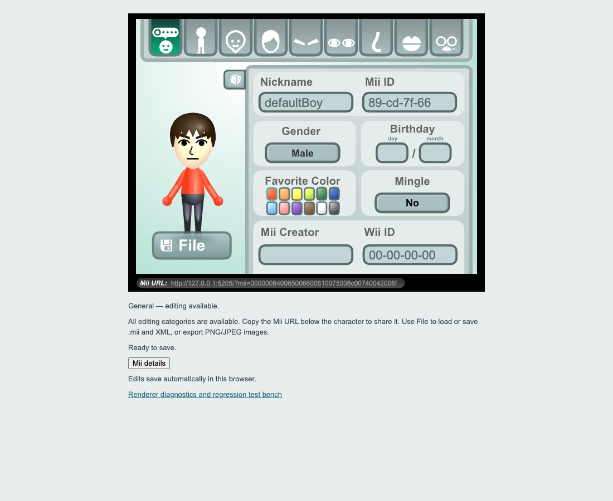

# Mii Editor Web

An unofficial browser-based recreation of the historical Mii Editor, using TypeScript and the recovered original vector graphics. Edit characters, save Wii-format records, share links and export images without Flash or a runtime backend.



## AI-generated / vibe-coded project — unmaintained

This is an unofficial browser-based recreation of the historical Mii Editor, developed with substantial assistance from AI coding tools.

This project is provided as-is. I do not intend to actively maintain it, provide technical support, review issues, or accept pull requests.

Bugs and compatibility issues may exist. Software validation does not guarantee compatibility with every Wii console or Wii game.

Forks and independent development are encouraged, subject to applicable licenses and asset rights.

This project is not affiliated with or endorsed by Nintendo or the original Mii Editor developers.

**Licensing is unresolved:** newly written code is currently unlicensed. Historical graphics and generated vector data have separate, unconfirmed redistribution rights. Public access is not a permissive license grant. Read [LICENSE.md](LICENSE.md) and [NOTICES.md](NOTICES.md) before reuse or redistribution.

## Features

- All 13 original editing categories, original-style layout and recovered SVG character graphics.
- Wii software-compatible creation/randomization by default, with bounded attributes and valid birthdays; no legacy-mode toggle.
- Local 74-byte `.mii` import/export, compatible XML, and PNG/JPEG image exports.
- Explicit before/after repair review for incompatible records; cancellation preserves the current character.
- Automatic browser saving and share links containing the complete character data.
- Standalone static website: no Flash, AIR, PHP, database, Node.js server, Vite server, account or cloud service at runtime.

## Download and start

Preview **v0.1.0-preview.2 is prepared locally and not published yet**. The existing [preview.1 release](https://github.com/jstack01/mii-editor-web/releases/tag/v0.1.0-preview.1) remains unchanged.

When preview.2 is approved, choose the ZIP for your platform:

| Edition | Startup | Requirement / coverage |
| --- | --- | --- |
| macOS | `Start Mii Editor.command` | Existing Python 3.9+; skips Apple's installation stub. |
| Linux | `start-mii-editor.sh` | Existing Python 3.9+; real Linux desktop verification pending. |
| Windows | `Start Mii Editor.cmd` | Real Python 3.9+ on PATH; actual Windows verification pending. |
| Static hosting | Upload index/assets/notices | No launcher or interpreter on the hosting server. |

Extract the complete ZIP and read START-HERE.md. The local script starts **http://127.0.0.1:8080/**, waits for the website to answer and opens your default browser. The same URL is printed for clicking/copying. Keep the terminal open; Ctrl+C or closing the terminal stops the server. Nothing is downloaded or installed by the launcher. If Python is missing, it explains optional installation from python.org. Zero additional installations are not guaranteed.

D1 preview.1 used port **8765**. Export its important Miis before switching to D2's **8080**, then import them; browser storage is tied to the origin. Localhost share links refer to the computer opening them and are not public website links. See [LOCAL_LAUNCHERS.md](docs/LOCAL_LAUNCHERS.md) for the Windows PowerShell investigation and testing limits.

Use the named prebuilt ZIP assets, not GitHub's automatic Source code archives (which require a developer build). Each artifact has a checksum; preview.1 remains available unchanged.

## Host it on a website

Upload **the contents of the static hosting ZIP**, including notices, to your static web directory. The same build uses relative asset URLs and works at the domain root or a folder such as `/mii-editor/`. Keep the trailing slash when sharing a directory URL.

Apache needs only normal static-file serving and JavaScript/CSS MIME types. No Node.js/Vite process, Python, PHP or database is needed on the production server. See [the hosting guide](docs/HOSTING.md) for root/subdirectory examples and HTTPS/browser limitations.

## Build from source

Install Node.js 22.12+ (Node 24 was used for verification) and pnpm, then:

```sh
cd web
pnpm install --frozen-lockfile
pnpm test
pnpm build
```

Deploy `web/dist/`. The public checkout builds independently from committed generated resources; it does not need the original SWFs, ActionScript, extraction folders or private recovery evidence. See [BUILDING.md](docs/BUILDING.md) for public tests, optional local legacy tests and asset recovery.

## Original Project and Credits

The original application and related materials were obtained from [the Nekoweb preservation site](https://mii-editor.nekoweb.org/) and [this Internet Archive item](https://archive.org/details/mii-editor). They are credited as sources where the materials were found, not assumed to have created the original editor.

Both the Nekoweb FAQ and the archive's creator metadata credit **senocular** as the original developer. Thank you to the original developer and the preservation-site maintainer, uploader and archivists. See [NOTICES.md](NOTICES.md) for attribution, third-party notices and unresolved asset rights. No ownership of Nintendo characters, the historical Flash application or its artwork is claimed.

## Preview limitations

Testing is primarily in desktop Chrome, with narrow viewport and emulated-touch checks. Full Firefox, Safari/WebKit, Edge, iOS and Android coverage is not complete. Standalone Wii-record software validation is tested; console ownership, destination ID uniqueness, actual transfers, game-specific containers/checksums and physical Wii/game acceptance remain unverified. This preview is not hardware-certified.

[The migration plan](MIGRATION_PLAN.md) retains browser/mobile work (6.2), remaining distribution verification (6.3), hardware/emulator/game checks (7) and final release checks (8). Making this repository public does not complete those milestones. Future releases are manual and explicit; see [PUBLISHING.md](docs/PUBLISHING.md).
