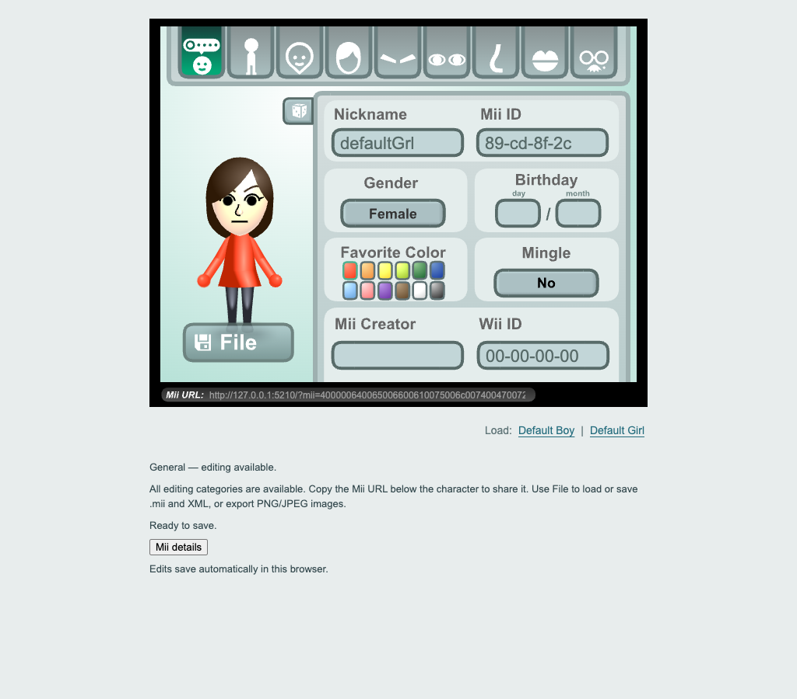

# Mii Editor Web

An unofficial browser-based recreation of the historical Mii Editor, using TypeScript and the recovered original vector graphics. Edit characters, save Wii-format records, share links and export images without Flash or a runtime backend.



## AI-generated / vibe-coded project — unmaintained

This is an unofficial browser-based recreation of the historical Mii Editor, developed with substantial assistance from AI coding tools.

This project is provided as-is. I do not intend to actively maintain it, provide technical support, review issues, or accept pull requests.

Bugs and compatibility issues may exist. Software validation does not guarantee compatibility with every Wii console or Wii game.

Forks and independent development are encouraged, subject to applicable licenses and asset rights.

This project is not affiliated with or endorsed by Nintendo or the original Mii Editor developers.

**Licensing is unresolved:** newly written code is currently unlicensed. Historical graphics and generated vector data have separate, unconfirmed redistribution rights. Public access is not a permissive license grant. Read [LICENSE.md](LICENSE.md) and [NOTICES.md](NOTICES.md) before reuse or redistribution.

## Features

- All 13 original editing categories, original-style layout and recovered SVG character graphics.
- Wii software-compatible creation/randomization by default, with bounded attributes and valid birthdays; no legacy-mode toggle.
- Local 74-byte `.mii` import/export, compatible XML, and PNG/JPEG image exports.
- Explicit before/after repair review for incompatible records; cancellation preserves the current character.
- Automatic browser saving and share links containing the complete character data.
- Historical Default Boy / Default Girl links below the editor; locally bundled presets with fresh software-valid IDs.
- Configurable loopback-only local server using config.json.
- Standalone static website: no Flash, AIR, PHP, database, Node.js server, Vite server, account or cloud service at runtime.

## Download and start

**v0.1.0-preview.4 / Docker D3 is prepared locally and not published yet.** Download the currently published [**v0.1.0-preview.3**](https://github.com/jstack01/mii-editor-web/releases/tag/v0.1.0-preview.3). [Preview.2 remains available](https://github.com/jstack01/mii-editor-web/releases/tag/v0.1.0-preview.2). The existing [preview.1 release](https://github.com/jstack01/mii-editor-web/releases/tag/v0.1.0-preview.1) remains unchanged.

Choose the ZIP for your platform:

| Edition | Startup | Requirement / coverage |
| --- | --- | --- |
| macOS | `Start Mii Editor.command` | Existing Python 3.9+; owner tested preview.2 on macOS; skips Apple's installation stub. |
| Linux | `start-mii-editor.sh` | Existing Python 3.9+; real Linux desktop verification pending. |
| Windows | `Start Mii Editor.cmd` | Real Python 3.9+ on PATH; owner tested preview.2 on Windows. |
| Static hosting | Upload index/assets/notices | No launcher or interpreter on the hosting server. |

Extract the complete ZIP and read START-HERE.md. The local script starts **http://127.0.0.1:8080/**, waits for the website to answer and opens your default browser. The same URL is printed for clicking/copying. Keep the terminal open; Ctrl+C or closing the terminal stops the server. Nothing is downloaded or installed by the launcher. If Python is missing, it explains optional installation from python.org. Zero additional installations are not guaranteed.

D1 preview.1 used port **8765**. Export its important Miis before switching to D2's **8080**, then import them; browser storage is tied to the origin. Localhost share links refer to the computer opening them and are not public website links. See [LOCAL_LAUNCHERS.md](docs/LOCAL_LAUNCHERS.md) for the Windows PowerShell investigation and testing limits.

Use the named prebuilt ZIP assets, not GitHub's automatic Source code archives (which require a developer build). Each artifact has a checksum; preview.1 remains available unchanged.

## Docker and Docker Compose (prepared for preview.4)

The same editor is packaged for `ghcr.io/jstack01/mii-editor-web:v0.1.0-preview.4`, targeting linux/amd64 and linux/arm64. **The first image is not uploaded yet; public package visibility and anonymous pulls remain approval gates.** The local launcher ZIPs and static hosting ZIP remain separate supported options. Docker contains no Python/Node/Vite/PHP runtime or database.

After publication:

```sh
docker pull ghcr.io/jstack01/mii-editor-web:v0.1.0-preview.4
docker run -d --name mii-editor -p 127.0.0.1:8080:8080 --restart unless-stopped ghcr.io/jstack01/mii-editor-web:v0.1.0-preview.4
```

Open http://127.0.0.1:8080/. Prefer the hardened command in [the Docker guide](docs/DOCKER.md), or download/extract the Docker starter ZIP and run `docker compose up -d`. The [ready-to-use compose.yaml](compose.yaml) has read-only storage and other hardening enabled. Use [.env.example](.env.example) / MII_EDITOR_PORT to change the Compose host port; Docker does not read launcher config.json. Miis remain in the browser/downloads, not the container.

See [DOCKER.md](docs/DOCKER.md) for stop/restart/remove/update/logs, host-port changes, reverse proxies and HTTPS. [DOCKER_VERIFICATION.md](docs/DOCKER_VERIFICATION.md) records native ARM64 versus emulated AMD64 coverage. Docker does not fix browser limitations or certify Wii hardware. All existing code/graphics licensing and unmaintained-project disclosures apply.

## Change the local port

To change the local server port, open config.json in a text editor, change the number next to port, save the file, and restart Mii Editor.

```json
{
  "port": 8090
}
```

This opens **http://127.0.0.1:8090/**. The normal default is 8080. Keep config.json beside the startup script and serve.py, outside website/. All three platform launchers use the same Python JSON parser. No parser installation is needed. If the file or port key is missing, the default is 8080. The file must be a JSON object; port must be a JSON integer from 1024 to 65535. Quoted numbers, true/false, decimals, invalid JSON and invalid ports produce a helpful error. Unknown keys are ignored; they cannot change the loopback binding or server security. Only port is currently supported. Never select another port silently when one is occupied.

Changing the port changes the browser storage origin. Characters previously saved at port 8080 may not appear at port 8090. **Export important .mii files before changing ports.** Keep the same browser/profile and chosen port between launches. Keep a backup of your config.json when updating to a new release and copy your chosen port into the new package. No automatic migration between ports is performed. The static-hosting ZIP does not contain or need config.json; Apache/Nginx supplies its own HTTP configuration.

## Host it on a website

Upload **the contents of the static hosting ZIP**, including notices, to your static web directory. The same build uses relative asset URLs and works at the domain root or a folder such as `/mii-editor/`. Keep the trailing slash when sharing a directory URL.

Apache needs only normal static-file serving and JavaScript/CSS MIME types. No Node.js/Vite process, Python, PHP or database is needed on the production server. See [the hosting guide](docs/HOSTING.md) for root/subdirectory examples and HTTPS/browser limitations.

## Build from source

Install Node.js 22.12+ (Node 24 was used for verification) and pnpm, then:

```sh
cd web
pnpm install --frozen-lockfile
pnpm test
pnpm build
```

Deploy `web/dist/`. The public checkout builds independently from committed generated resources; it does not need the original SWFs, ActionScript, extraction folders or private recovery evidence. See [BUILDING.md](docs/BUILDING.md) for public tests, optional local legacy tests and asset recovery.

## Original Project and Credits

The original application and related materials were obtained from [the Nekoweb preservation site](https://mii-editor.nekoweb.org/) and [this Internet Archive item](https://archive.org/details/mii-editor). They are credited as sources where the materials were found, not assumed to have created the original editor.

Both the Nekoweb FAQ and the archive's creator metadata credit **senocular** as the original developer. Thank you to the original developer and the preservation-site maintainer, uploader and archivists. See [NOTICES.md](NOTICES.md) for attribution, third-party notices and unresolved asset rights. No ownership of Nintendo characters, the historical Flash application or its artwork is claimed.

## Preview limitations

Chrome, bundled Chromium and Playwright WebKit have automated desktop and emulated touch-viewport coverage. Firefox’s Playwright runtime could not start due to macOS helper/sandbox failures, and installed Safari remote automation is disabled. Edge and physical iOS/Android environments were unavailable. Engine emulation does not certify mobile Safari/Android Chrome or native keyboards. WebKit’s forced-offline file/image tests still fail, although normal and HTTP-blocked operations pass; native Safari offline behavior is unverified. Full cross-browser/device coverage is not complete. See [the browser matrix](docs/BROWSER_COMPATIBILITY.md). Standalone Wii-record software validation is tested; console ownership, destination ID uniqueness, actual transfers, game-specific containers/checksums and physical Wii/game acceptance remain unverified. This preview is not hardware-certified.

[The migration plan](MIGRATION_PLAN.md) retains browser/mobile work (6.2), remaining distribution verification (6.3), hardware/emulator/game checks (7) and final release checks (8). Making this repository public does not complete those milestones. Future releases are manual and explicit; see [PUBLISHING.md](docs/PUBLISHING.md).
