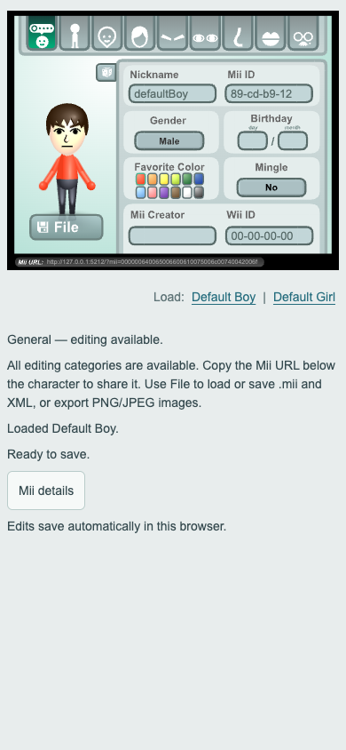

# Phase 8A — software QA and preview.5 readiness

Phase 7B is **deferred indefinitely by owner decision**. The owner will not obtain a Wii or perform physical tests. Real-Wii/game certification remains unverified and is not a browser-release blocker. This report covers software QA only; no additional Mii editing feature, ownership conversion or binary format is introduced.

## Changes

- Lost mouse-button cleanup ends body/XML/image-slider/pan drags before changing values, and clears captured hover state. Firefox exposed the missing-release path; new browser regressions check capture, unchanged data/settings and camera state.
- Repair cancellation now reports immediately, so its delayed focus-restoration callback cannot erase a newer import error. The regression deliberately delays callbacks and preserves both the error and exact character bytes.
- Horizontal overscroll containment prevents an observed Linux Chromium touch-slider gesture from navigating back to about:blank; vertical scrolling and pinch zoom stay enabled.
- The development renderer bench fits its fixed surface with Linux/Firefox font metrics; no content clipping or renderer-coordinate change hides the previous assertion.
- Modern HTML buttons have practical minimum targets, and numeric/technical text fields provide keyboard/autocapitalization hints. The original SVG art, 640×500 stage and all feature calculations remain.
- Local HTTP responses now include no-referrer protection. Query-based sharing/privacy limits are documented accurately. Packaged guides retain working local links and versioned links to optional online technical documents.
- The test harness supplies a verified synthetic clipboard payload on Firefox and records its independent pointer-delivery limitation. Original fractional/value/pixel/dimension/byte assertions are retained; WebKit failures remain nonzero.

## Executed software coverage

200 public tests, 447 public plus historical tests, 70 launcher/config/distribution guards and seven protected-source checks cover the unchanged data/graphics/editor/export layers. The independent pinned MiiJS check covers 10,000 deterministic records; calendar/identity rules stay separate. No routine Dolphin database mutation is rerun: Phase 7A fixtures, checksum/identity safeguards and retained emulator evidence remain the destination baseline.

The browser matrix and exact environment limitations are in [BROWSER_COMPATIBILITY.md](BROWSER_COMPATIBILITY.md). Chrome/macOS, Firefox/isolated Ubuntu and Chromium/isolated Ubuntu passed 21/21. macOS WebKit is 16/21 with the five documented forced-offline failures retained. WebKit's existing forced-offline file/image failures and no-editor primitive failures remain recorded on macOS/Linux; normal HTTP-blocked/no-external-network flows are not substituted for them. Branded Safari/Edge, Windows desktop and physical iOS/Android are not certified.

Mobile QA covers seven portrait/landscape phone/tablet sizes, all category paths with representative native-emulated taps, slider keys/Chromium touch dragging, preset links, viewport shrink/data stability, long filenames, dialog scrolling and cancellation. It cannot certify physical virtual keyboards or native OS file/download interfaces.

## Distribution gates and local evidence

Preview.5 comprises Windows/macOS/Linux local ZIPs, static ZIP, Docker starter ZIP, per-file manifests and SHA-256 inventories. Local editions include config.json and require existing Python 3.9+; static hosting and Docker require no application backend. Every final archive must be extracted, hashed and tested, not inferred from Vite. Public source builds must work without private originals.

The packaging gate covers exact 74-byte Mii/XML/PNG/JPEG operations, repairs/cancel, all categories, presets, origin-stable persistence/restart and share URLs at root/nested paths. Local process checks cover config defaults/custom/invalid/missing values, port conflicts, loopback/Host/path safety, browser-open/readiness/terminal links and shutdown. macOS process tests and headless Linux process tests are distinguished from Windows/native desktop interaction; no Windows VM or physical phone is claimed. Apache checks use an isolated local Apache configuration, not an arbitrary production TLS host.

The matching preview.5 Docker build must use the reviewed source revision; the public preview.4 image must not be relabeled as new application code. Validate both linux/arm64 and linux/amd64 images and their immutable architecture metadata; ARM64 runs natively relative to this Docker VM and AMD64 is emulated. Verify actual runtime files, health, headers, UID, readonly/capability restrictions, custom loopback ports, graceful shutdown and Compose/browser restart. No new image/tag is public until approval and anonymous registry checks.

All four extracted runtime ZIPs, the Docker starter, both runtime architectures and Compose/browser/restart checks passed. The same application asset bytes are present in every runtime edition. The local OCI index contains amd64 and arm64; no new registry tag is public. A verifier metadata fallback handles local Buildx indexes without relaxing architecture checks. Headless Linux actually executed its extracted script at default/custom ports with terminal hyperlinks and a readiness-validating browser request; macOS actually launched its extracted command and requested the default browser. Windows desktop/Finder/quarantine coverage remains qualified as above.

Final local verification logs, package manifests/checksums, architecture reports and screenshot sets live under ignored `release/phase8a/` and the versioned `release/` artifacts; these are not runtime release contents. The completion report identifies final successes/failures and source revision. This document describes the gates without calling unavailable hardware or retained WebKit failures passed.

## Security, privacy and known limits

See [SECURITY_PRIVACY.md](SECURITY_PRIVACY.md). Imports/edits/encoding are local and browser request checks reject unexpected third-party/historical-service traffic. **Opening a share URL does send its character query to the chosen HTTP host.** Bundled local/Docker servers suppress normal query logs; conventional hosts/proxies must configure theirs. XML remote declarations are stripped and internal entities rejected; names are rendered as text. Runtime distributions exclude original Flash materials, evidence, source/tests, credentials and development dependencies/diagnostics.

The lockfile dependency audit reported no advisories at this test date; this is not a formal security audit or a certification of every Nginx/OS/browser component. New code remains unlicensed; historical artwork/vector rights remain unresolved. Original credits and AI-generated/unmaintained notices are unchanged. Tutorial sequencing, some historical font/nine-slice/antialiasing differences, WebKit protocol-offline behavior and untested native browsers/devices remain disclosed.

## Owner review and Phase 8B

Inspect the seven-viewport screenshots and current browser interface, then extract the appropriate preview.5 ZIP and run its launcher (existing Python required). Try defaults, randomization, representative categories, file/XML/image saves, a failed import/cancel and a repair. Restart at the same port/browser profile to check persistence. Export important Miis before changing origins. No Wii, discs, NAND image or new equipment is requested.

Phase 8B needs explicit approval to push/tag/publish the GitHub prerelease and matching GHCR version. Previous previews/images remain intact. Final publication also updates concise homepage links from the currently published preview.4 to preview.5 and removes the candidate-only Docker wording; rerun metadata/package gates after those documentation changes. Nothing publishes on ordinary commits.
